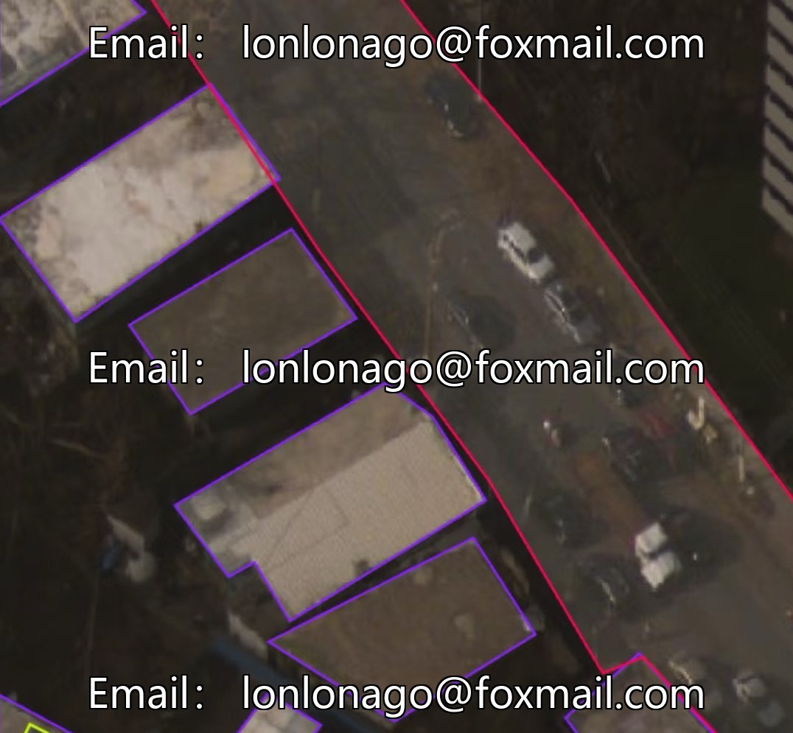
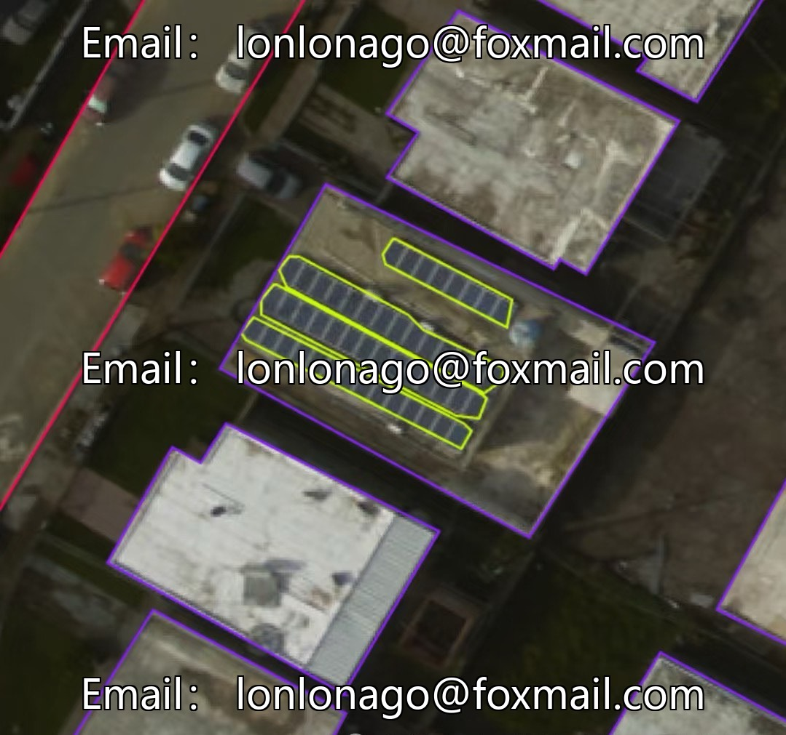
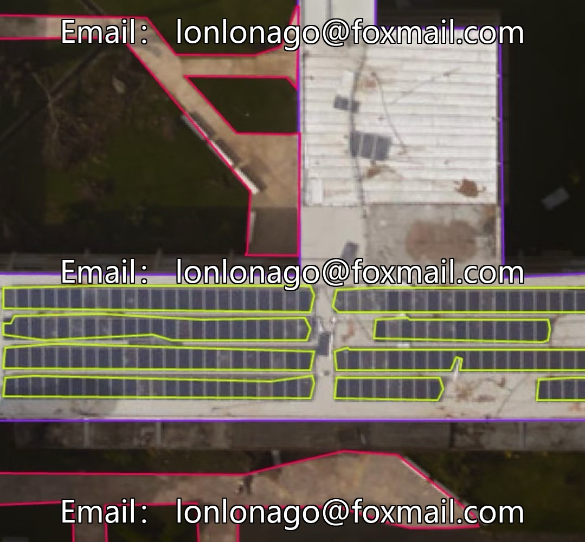
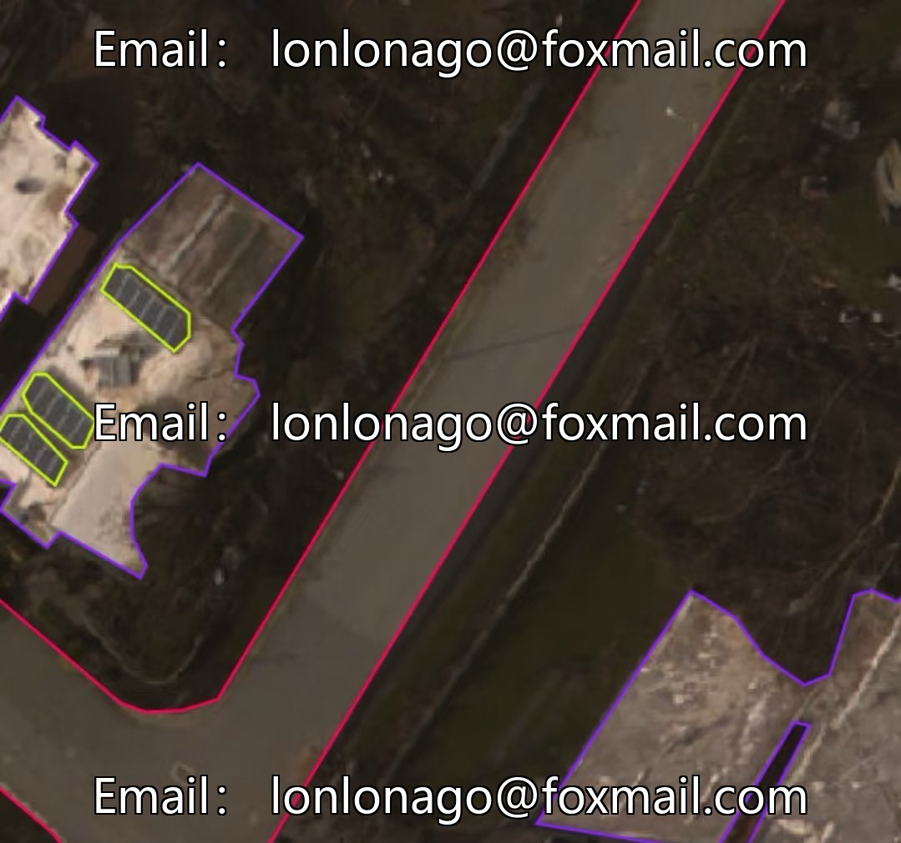

# Drone-viewed post-hurricane building and facility inspection dataset (YOLO format), Dataset ID 1

## Body

Drone-viewed post-hurricane building and facility inspection dataset (YOLO format), Dataset ID 10592
Based on real aerial/remote sensing scenes after hurricanes, including five categories of labels such as roads, rooftops, photovoltaic panels, inverters, and water towers, totaling 860 images. The format is YOLO labeling, supporting conversion to instance segmentation mask format.
The dataset covers multiple lighting conditions and angles, enhancing the model's robustness. It is suitable for tasks such as post-disaster damage assessment, emergency response, facility inspection, and post-disaster reconstruction planning. It can be directly used for training, validation, and engineering implementation of target detection and instance segmentation models.

Virtual materials, once sold, are non-refundable.
Interested friends, click "I want" to proceed.

## Images

## Payment

Here is a pay link on Stripe ( https://buy.stripe.com/3cs8yP7sY87d0vu9AB ). Please contact me lonlonago@foxmail.com after funding $89, and I will send you a complete data files , thank you!

